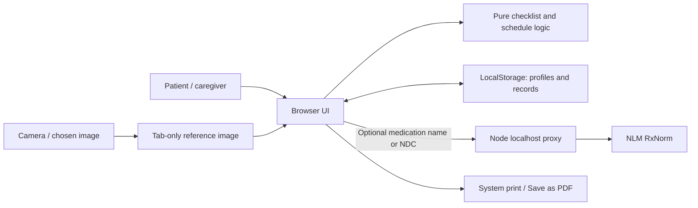

# Architecture

The dependency-free Node server serves the public folder and exposes one read-only endpoint, `/api/drugs?q=...`. It calls a fixed NLM hostname with length-limited query input and timeouts. It has no health-record API, database, arbitrary URL proxy, or file upload handler.

Browser state is versioned under `pillcheck-v1`. Each profile contains medication descriptions, dose logs, refill notes, and manual compartment marks. UUIDs identify records. Logs snapshot the medication names, strengths, quantities, and review observations at the time of logging. Existing logs survive plan changes. The current chart uses the current medication schedule retrospectively; historical schedule changes can therefore affect the denominator. This is a known limitation and must be fixed before longitudinal clinical use.

A dose is one scheduled period for one profile on a local calendar date. A taken record blocks a second taken record for the same period and date. Concern records do not block later reviews. Storage events refresh other open tabs, and a final checklist check runs before logging. This is not a transactional database: truly simultaneous writes in multiple tabs can still conflict. Use one active tab for record entry.

The checklist is conservative but not clinical: a matching count and a manually confirmed appearance return `reviewed`. Empty/missing reports, wrong counts, uncertain appearance, previously logged periods, and mismatched periods receive separate outcomes. No result says that an image has been classified or that medication is safe to take.

This prototype uses broad local-time periods, with no prescription-specific exact times, PRN schedules, tapers, liquid doses, units other than whole pills, or alternate-day plans. It should not be used for these regimens.
