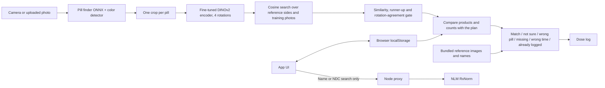

# Architecture

Detection, recognition and plan matching all run in the browser. The service worker (`public/sw.js`) caches the app and the models so scanning works offline, and the web app manifest makes PillCheck installable on phones. The server has no upload or inference endpoint. Its only job besides serving files is the RxNorm proxy, which uses a fixed host, limits input length and times out slow requests. ONNX Runtime's JavaScript and WASM files are served from an allowlist inside the installed `onnxruntime-web` package.

The recognizer searches the whole library before looking at the plan. If it only searched the planned medicines, a wrong pill could easily be mislabeled as one of them. Dataset identities that share a product NDC are merged during ranking, and package suffixes are ignored because they don't change how a pill looks.

The models load once per tab. A generation counter stops a scan that finishes late from updating a different profile. Photos stay in tab memory. Dose logs store candidate IDs, scores, margins, whether each match was accepted, and timing, but never image data.

App state is versioned under the `pillcheck-v1` key. Each profile holds its medications, dated dose logs, refill notes and organizer marks. Only one taken record is allowed per date and dose time, and the scan result is checked again right before logging. Changes made in one tab show up in other open tabs through storage events.
