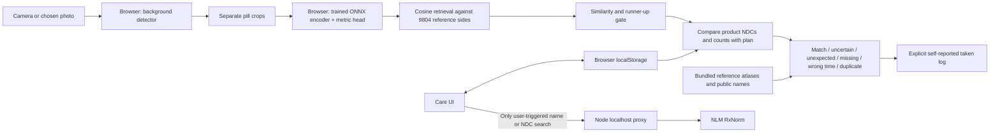

# Architecture

Photos, inference, embeddings, and detection run in the browser. The server exposes no photograph upload or inference endpoint. The optional RxNorm proxy uses a fixed host, length-limited input, and timeouts. Runtime JavaScript/WASM is served from an explicit three-file allowlist inside the installed `onnxruntime-web` package.

The recognizer searches the complete library before checking the plan. Restricting retrieval to expected pills would make an incorrect pill too easy to mislabel as an expected one. Duplicate dataset identities of the same normalized product NDC are merged during ranking. Candidate NDCs are compared with the plan's labeler/product; package suffixes are not visual identities.

The neural model is loaded once per tab. A generation counter prevents a stale scan from updating a different profile after navigation. User photos remain in tab memory. Dose logs store candidate IDs, scores, margins, acceptance flags, and elapsed time; they do not store image data.

Versioned state is stored under `pillcheck-v1`. Each profile has medications, dated self-reported logs, refill notes, and manual organizer marks. A taken record blocks another record for the same local date and period. A final scan-result check runs before logging. Storage events refresh other tabs, but simultaneous writes can still conflict. Use one entry tab.
