# PillCheck · Demo video script (Congressional App Challenge 2026)

**Due 12:00 pm EDT, Monday, October 26, 2026** (11:00 am CDT, 10:00 am MDT, 9:00 am PDT). The submission can't be changed after the deadline.

Video rules (from the [2026 CAC Rules](https://www.congressionalappchallenge.us/wp-content/uploads/2026/05/2026-CAC-Rules.pdf)): 1 to 3 minutes, uploaded to YouTube or Vimeo and set to **Public**. It must include each participant's name, the app name, the purpose in one clear sentence, the target audience, the tools and coding languages, and the app working. AI use must be fully disclosed in the submission materials.

This script runs about **2:50**. Screens are in [`demo-shots/`](demo-shots/).

## Which shot covers each rule

| Required item | Shot |
|---|---|
| Name of each participant | 2, and the end card in 9 |
| Name of the app | 2 and 9 |
| Purpose in one clear sentence | 2 (said aloud and shown as a caption) |
| Target audience | 2 |
| Tools and coding languages | 8 |
| The app working | 3 to 7 |

## Who says what

Ethan opens and closes, Ian runs the live demo, and Brandon covers the family features and how the app is built. Swap shots if it suits you better; the timing stays the same.

| Person | Shots | Words | Talking time |
|---|---|---:|---:|
| Ethan | 1 (hook), 2 (name, purpose, audience), 9 (closing line) | 98 | ~39 s |
| Ian | 2 (name), 3 (demo plan), 4 (wrong pill), 5 (match), 6 (flip) | 124 | ~50 s |
| Brandon | 2 (name, school), 7 (family features), 8 (how it's built) | 132 | ~53 s |

Brandon takes shot 8, so be ready for judges' questions about the model and code. If Ethan or Ian knows the model better, swap that shot.

## Script

Taps are written exactly as the buttons read in the app.

### 1 · Hook · 0:00–0:20 · Ethan

**Show:** hands filling a weekly pill organizer (vitamins or mints, never someone's real prescription), or the statistic card.
**Caption:** 1.5 million+ emergency visits a year from medication harm · CDC

> Every year, medication harm sends more than 1.5 million people in the U.S. to the emergency room, over 600,000 of them 65 or older. Almost half of older adults take five or more medicines. With that many pills, a wrong one is easy to miss.

### 2 · Who, what, for whom · 0:20–0:40 · Ethan, Ian, Brandon

**Show:** the team on camera with name captions, then cut to the Welcome screen on "this is PillCheck".
**Caption:** PillCheck uses your phone's camera to check that the pills in your hand match your prescription before you take them.

> **Ethan:** Hi, I'm Ethan.
>
> **Ian:** I'm Ian.
>
> **Brandon:** And I'm Brandon, from [School].
>
> **Ethan:** This is PillCheck. PillCheck uses your phone's camera to check that the pills in your hand match your prescription before you take them. It's built for older adults who take several medicines, and for the family members and caregivers who help them.

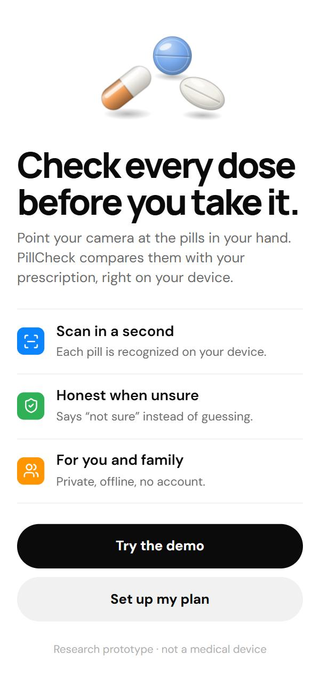

### 3 · Demo plan · 0:40–0:47 · Ian

**Tap:** Try the demo

> Here's a demo plan with four medicines. Today shows every dose: morning, evening and bedtime.

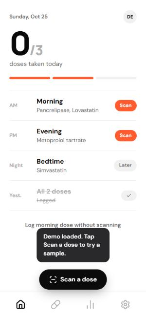

### 4 · Wrong pill · 0:47–1:07 · Ian

**Tap:** Scan a dose → No pills? Try a sample → Wrong pill. Hold on the result for 3 seconds.
**Shows:** "Wrong pill." Minocycline 50 mg, "Not in your plan", main button "Report a problem".

> To check a dose, you tap Scan and point the camera at your pills. We're using real photos from an NIH pill dataset. This capsule isn't in the plan, so PillCheck says Wrong pill, and offers to report a problem instead of logging the dose.

Do this **before** logging the morning dose. After a dose is logged, a new scan of it says "Already logged."

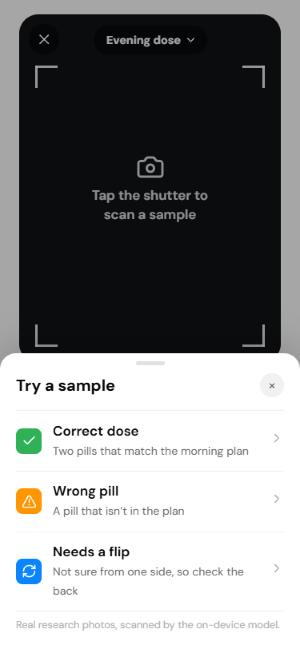 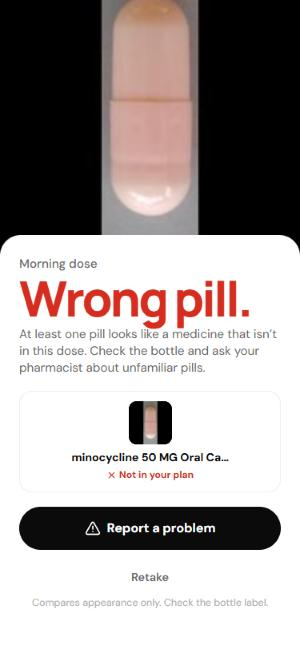

### 5 · Match · 1:07–1:24 · Ian

**Tap:** Retake → No pills? Try a sample → Correct dose (let the scan finish) → Log dose → Done
**Shows:** "Match." "2 of 2 pills match your morning plan." then "Logged."

> Now the right dose. PillCheck finds each pill, checks both against the morning plan, and says Match. One tap logs the dose.

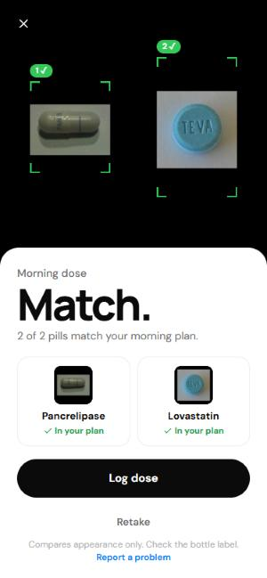 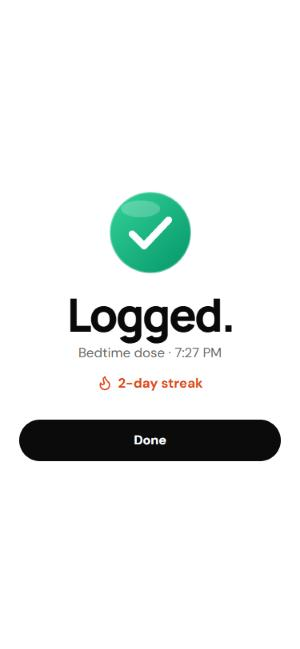

### 6 · Flip to confirm · 1:24–1:50 · Ian

**Tap:** Scan a dose → No pills? Try a sample → Needs a flip → Scan the other side of pill 1 → shutter
**Shows:** "Flip to confirm." then "Pill 1 · other side", then "Match." "Simvastatin · Both sides match".

> Some pills look almost the same from one side. When PillCheck isn't sure, it doesn't guess. It asks you to flip the pill. We scan the other side, PillCheck combines both photos, and now it's sure: simvastatin, both sides match.

Pause after "it doesn't guess."

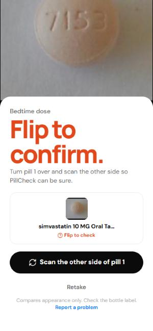 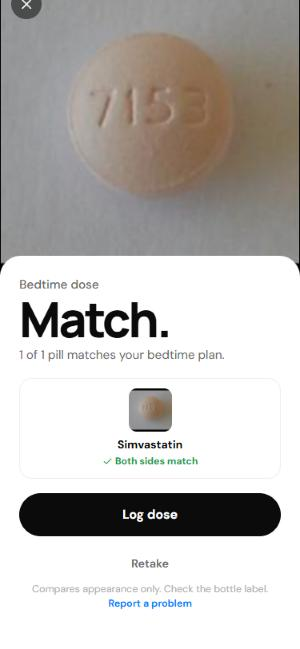

### 7 · For families · 1:50–2:08 · Brandon

**Tap:** ✕ (close scanner) → pill tab (Look-alike pills warning) → chart tab (History, Print a report for the doctor) → gear tab → Larger text on

> PillCheck also warns you when two of your medicines look alike, tracks your week, and prints a report for your doctor. Larger text and spoken guidance in English, Spanish and Mandarin help the whole family use it.

If the full read runs long, cut this shot's second sentence first.

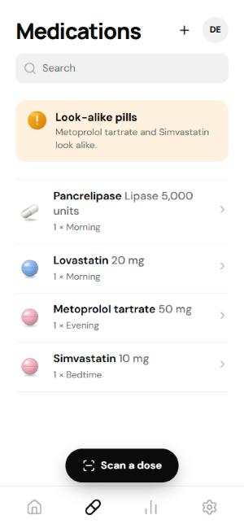 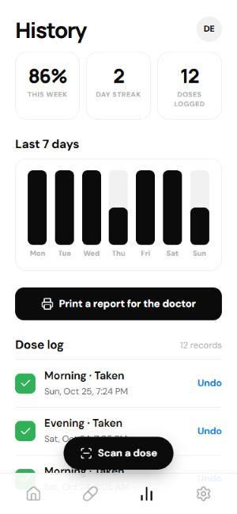 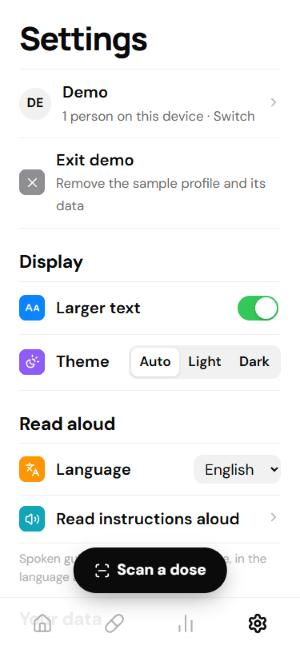

### 8 · How it's built · 2:08–2:42 · Brandon

**Show:** the "How PillCheck works" card (photo → find each pill → on-device model → plan check; JavaScript, HTML, CSS, Node.js, Python, PyTorch, ONNX Runtime Web; 98.3% right when confident; 96% of look-alikes caught). Optionally 3 seconds of `public/recognition-core.js` in the editor.

> PillCheck is a web app in JavaScript, HTML and CSS, with a Node.js server. Its pill model, a DINOv2 vision transformer, was fine-tuned in Python with PyTorch on nearly 5,000 pill types, and it runs on the phone itself, so photos never leave the device. On 960 photos it never trained on, it was right 98 percent of the time when it was confident, and the flip step caught 96 percent of look-alike pills. We used an AI coding assistant for parts of the build, and our written answers say exactly where.

### 9 · Close · 2:42–2:50 · Ethan, then everyone

**Show:** end card with names, school, district, github.com/brandonlign/pillcheck, "Research prototype, not a medical device". Hold 3 seconds.

> **Ethan:** PillCheck. Check every dose before you take it.
>
> **Everyone:** Thanks for watching!

## Recording setup

1. `npm start`, then open http://localhost:4173 in Chrome. F12, then Ctrl+Shift+M for phone view (for example iPhone 12 Pro, zoom 100%).
2. Open the app once and let the model finish loading. Do a full dry run of shots 3–7.
3. Reset: Settings → Exit demo, then reload. You should see "Try the demo". If you see "Continue", a plan is still saved; exit the demo again.
4. Settings → Theme → Light, Larger text off. Close other tabs, hide the bookmarks bar, turn on Do Not Disturb.
5. Record the phone area with Snipping Tool (Win+Shift+R) or OBS, one clip per shot.
6. Record each shot's lines separately in a quiet room, then combine in Clipchamp, CapCut or iMovie. Add auto-captions and fix words like "DINOv2" and "simvastatin".
7. Export 1080p, check the length is 1:00–3:00, upload as **Public**, and test the link in a private window.

On a real phone (`HOST=0.0.0.0 npm start`, open `http://<laptop-ip>:4173` on the same Wi-Fi), the samples work but the live camera doesn't: browsers only allow the camera on `localhost` or `https`.

## AI disclosure (draft, complete it truthfully)

- **AI tools:** An AI coding assistant. Add every other AI tool any teammate used (the repo includes `opencode.json`, so check for OpenCode).
- **Where AI helped:** redesigning the interface; writing and running the Python scripts that fine-tune and evaluate the pill model; the plan-aware check and flip-to-confirm logic and their tests; preparing the demo sample photos; documentation, including this script.
- **What we did ourselves:** fill in specifically for each teammate.
- **Open-source tools and data:** ePillID benchmark (NIH National Library of Medicine pill images), DINOv2 (Meta AI), PyTorch and timm, ONNX Runtime Web (Microsoft), RxNorm API (NLM), Lucide icons, DM Sans and Manrope fonts.

Written-answer drafts for the six form questions, title cards and a live checklist are on the shared script page.

## Sources

- CDC, [FastStats: Medication Safety Data](https://www.cdc.gov/medication-safety/data-research/facts-stats/index.html): more than 1.5 million emergency visits a year for adverse drug events; adults 65+ more than 600,000.
- Shehab N. et al., [JAMA 2016](https://jamanetwork.com/journals/jama/fullarticle/2585977): emergency visits for outpatient adverse drug events, 2013–2014.
- Wang X. et al., [2023, PMC10337167](https://pmc.ncbi.nlm.nih.gov/articles/PMC10337167/): 44.1% of adults 65+ took five or more drugs in 2017–2018.
- Model numbers: [`MODEL_CARD.md`](MODEL_CARD.md) and `public/models/evaluation.json`.
